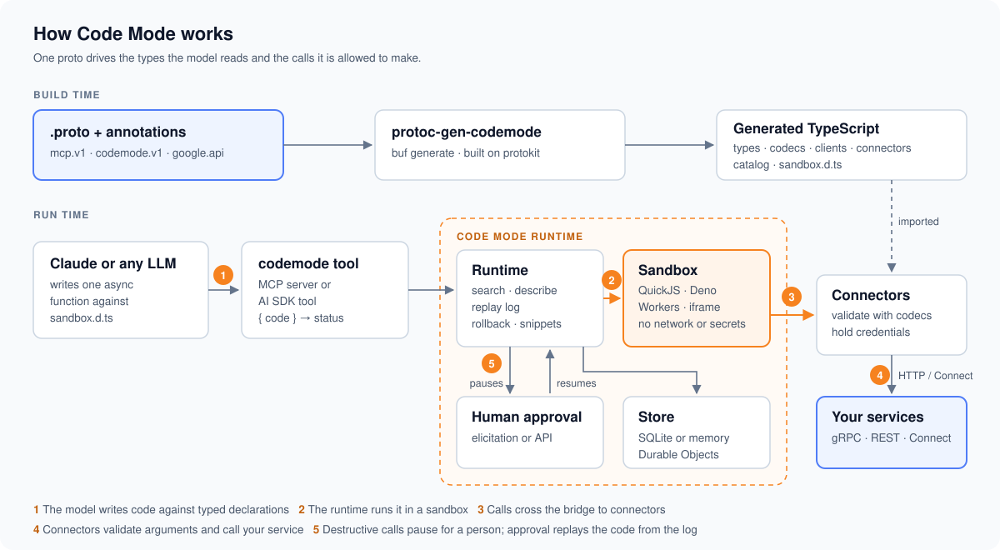

<!-- markdownlint-disable MD041 -->
<h1 align="center">Code Mode</h1>

<p align="center">
  <strong>Typed, sandboxed Code Mode for AI agents, generated from your <code>.proto</code> files.</strong>
</p>

<p align="center">
  <a href="https://github.com/the-protobuf-project/codemode/actions/workflows/ci.yaml"></a>
  
  <a href="LICENSE"></a>
  
</p>

> [!WARNING]
> **Work in progress.** The plugin, runtime and example work end to end and are
> tested on Node, Bun and Deno, but nothing is released yet and the APIs may change.

## Overview

[Code Mode](https://developers.cloudflare.com/agents/tools/codemode/) gives a
model one tool that runs code instead of one tool per API call. The model writes
a short async function against a typed API; a sandbox runs it. The function can
chain calls, loop, branch and return only what it needs.

`protoc-gen-codemode` builds that API from the protobuf services you already have:

- **Typed messages** as TypeScript interfaces, with protojson and binary codecs
- **Clients** over HTTP transcoding (`google.api.http`) or Connect, JSON or binary
- **Connectors** that expose each service in the sandbox, with approval, replay and rollback
- **A catalog** and `sandbox.d.ts` that tell the model what it can call, including what comes back

Code Mode built from MCP tools types results as `unknown`, because most MCP tools
have no output schema. A proto describes the full response, so the model knows
the result's shape and chains calls correctly.

<p align="center">
  
</p>

## Try it with Claude

The library example runs as an MCP server on stdio, with one `code` tool. You
need Node 22.18+ (it runs the TypeScript directly) and the repository:

```sh
git clone https://github.com/the-protobuf-project/codemode.git
cd codemode && npm install
```

**Claude Code**

```sh
claude mcp add library -- node --conditions=source "$PWD/examples/library/src/mcp.ts"
```

**Claude Desktop**: add this to `claude_desktop_config.json` (Settings → Developer →
Edit Config), using absolute paths. Desktop apps do not see your shell's `PATH`,
so give the full path of `node` (`which node`):

```json
{
  "mcpServers": {
    "library": {
      "command": "/absolute/path/to/node",
      "args": ["--conditions=source", "/absolute/path/to/codemode/examples/library/src/mcp.ts"],
      "env": { "CODEMODE_DB": "/absolute/path/to/library.db" }
    }
  }
}
```

**Other MCP clients** (Cursor, VS Code, Zed, the MCP Inspector) take the same
command. To look at the tools first:

```sh
npx @modelcontextprotocol/inspector node --conditions=source examples/library/src/mcp.ts
```

Then ask something that needs several calls, for example *"Which shelves have
books, and lend the shortest poetry book to Ada for a week"*, or *"Archive the
fiction shelf"* to see an approval pause. `CODEMODE_DB` is optional: set it to
keep executions in SQLite across restarts. The library itself is in memory and
resets when the server starts.

> [!NOTE]
> When the client supports MCP elicitation, approvals are asked there. Otherwise
> the server returns `paused` and the model resumes with `codemode_approve`, so
> leave that tool on "ask before running" in your client: its permission prompt
> is the human approval.

## How it works

**1. Annotate.** Annotations from [`protoc-gen-mcp`](https://github.com/the-protobuf-project/mcp)
work as they are. `codemode.v1` adds rollback, replay, snippets and the sandbox namespace.

```proto
service LibraryService {
  option (codemode.v1.service) = { namespace: "library" };

  rpc CreateBook(CreateBookRequest) returns (Book) {
    option (google.api.http) = { post: "/v1/{parent=shelves/*}/books" body: "book" };
    option (codemode.v1.method) = {
      revert: { method: "DeleteBook" fields: { key: "name" value: "result.name" } }
    };
  }

  rpc ArchiveShelf(ArchiveShelfRequest) returns (ArchiveShelfResponse) {
    option (mcp.v1.tool) = { destructive: true };  // pauses for approval
  }
}
```

**2. Generate** with `buf generate`. Every message gets an interface and a codec:

```ts
export interface Book {
  name?: BookName;                 // `shelves/${string}/books/${string}`
  title: string;
  state?: BookState;               // "BOOK_STATE_AVAILABLE" | "BOOK_STATE_LENT" | ...
  pageCount?: string;              // 64-bit integers stay exact
  createTime?: string;             // RFC 3339
}
export const BookCodec: MessageCodec<Book>;  // fromJson, toJson, encode, decode
```

**3. Run.** Wire the generated connectors into the runtime and hand the model one tool:

```ts
import { createCodemode, httpTransport } from "@the-protobuf-project/codemode";
import { QuickJSExecutor } from "@the-protobuf-project/codemode/quickjs";
import { catalog, config, connectors, libraryV1 } from "./gen/index.ts";

const client = new libraryV1.LibraryServiceClient(httpTransport({ baseUrl: "https://library.example.com" }));
const runtime = createCodemode({ catalog, config, connectors: connectors({ library: client }), executor: new QuickJSExecutor() });

await runtime.execute({ code: `async () => {
  const page = await library.listBooks({ parent: "shelves/poetry" });
  return page.books.map((b) => b.title);
}` });
// { status: "completed", result: ["Leaves of Grass", "Odes", "Ariel"] }
```

A call that needs approval returns `{ status: "paused", pending: [...] }`;
`runtime.approve()` resumes it, replaying earlier calls from the log instead of
running them again. `runtime.rollback()` undoes applied calls through their
generated reverts.

## Features

| Feature | Where it comes from |
| --- | --- |
| Typed inputs **and outputs** | Proto messages, enums, `google.api.resource` names |
| `search` and `describe` | Generated catalog; progressive or inline discovery |
| Approval pauses with durable resume | `mcp.v1.tool.destructive`, `mcp.v1.elicitation`, `codemode.v1.method.approval` |
| Replay and `codemode.step()` | Recorded call log; `codemode.v1.method.replay` |
| Rollback | `codemode.v1.method.revert` generates the compensating call |
| Snippets | `codemode.v1.service.snippets`, plus `saveSnippet()` at run time |
| History, limits, hooks, truncation | Runtime, configured by `codemode.yaml` |
| Sandboxes | QuickJS (Node, Bun, Deno, browser), Deno subprocess, Cloudflare Worker Loader, iframe |
| Stores | Memory, SQLite (`bun:sqlite`, `node:sqlite`), Durable Object SQL |
| Surfaces | Framework-neutral tool, MCP server (`code` or `search` + `execute`), Vercel AI SDK |
| Allowlisted `fetch` | `executor.outbound: allowlist`; responses replayed with the log |

## Layout

```
protobuf/codemode/v1/      codemode.v1 annotations (protobuf/codemodepb: Go types)
plugin/                    protoc-gen-codemode, on protokit
packages/runtime/          @the-protobuf-project/codemode: codecs, transports, sandboxes, runtime
examples/library/          annotated protos, generated code, an in-memory service, tests
schema/                    JSON Schema for codemode.yaml
docs/                      annotations, configuration, generated code, runtime, security
```

## Documentation

- [Annotations](docs/annotations.md): what `codemode.v1` adds and how `mcp.v1` is read
- [Configuration](docs/configuration.md): `codemode.yaml` and plugin parameters
- [Generated code](docs/generated-code.md): the folder structure and the TypeScript it contains
- [Runtime](docs/runtime.md): executions, approvals, replay, rollback, executors, stores, MCP
- [Security](docs/security.md): what the sandbox can and cannot reach

## Development

Requires Go 1.26+, [buf](https://buf.build), Node 22.18+ and [just](https://just.systems);
Bun and Deno to run those suites.

```sh
npm install
just generate        # build the plugin and regenerate examples/library/gen
just test            # Go tests (including a golden test of the example), type-check, Node tests
just test-runtimes   # the same TypeScript tests on Bun and Deno
just lint            # buf lint, go vet, and the 200-line limit on hand-written files
```

## License

Licensed under the [Apache License, Version 2.0](LICENSE).

Copyright 2026 The Protobuf Project authors.
